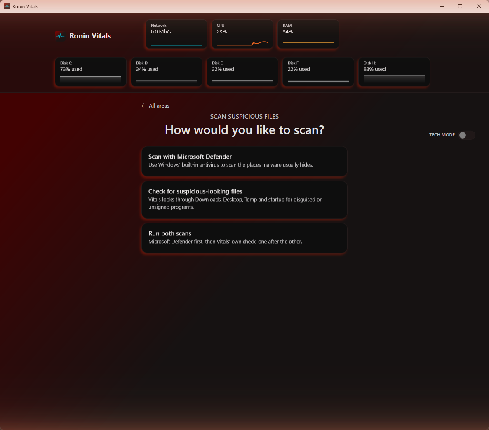
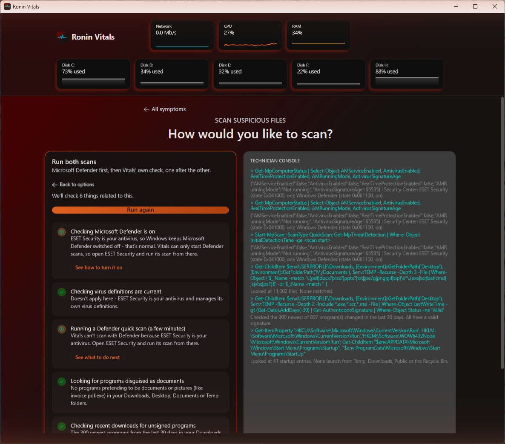

# Ronin Vitals

A Windows diagnostic and repair tool for people who are not technical. Pick what feels wrong ("my internet feels slow", "Wi-Fi keeps dropping"), press one button, and Vitals runs the relevant checks, explains each result in plain language, and tells you what to do about it: a fix you can do yourself, a fix Vitals can apply for you, or a clear "this needs a technician / your ISP / your IT department".

A **Tech Mode** switch reveals the same results the way a technician wants to see them: the exact command behind each check and the raw numbers, plus a live PowerShell console.

> **Status: early and under active development.** Every symptom card now runs real checks, with guidance for each result. See [What works today](#what-works-today) for what was verified how.


## How it works

You choose an area, then a symptom. Each symptom is a card with a short list of checks.


Opening a card shows a short "Gathering information" step, then the checklist. Press **Run diagnostic** and the checks run one at a time. Each ends as pass, warning or problem, with a one-line explanation. Anything that is not a pass has a button underneath that either explains what to do or, where it is safe, does it for you.


In the screenshot above this PC's Wi-Fi is disconnected (it is on Ethernet), so the signal and interference checks say so instead of pretending to measure something. The power-saving check found a real setting worth changing, and offers a button for it.

### Tech Mode

Flip **Tech Mode** on and the checklist slides left while a **Technician Console** opens beside it. For every check it shows the command behind the result (or the closest PowerShell equivalent, for checks that call .NET or WMI directly) and the raw reading, instead of the friendly sentence. The box underneath is a real PowerShell session you can type into.


The checklist on the left stays exactly as a normal user would see it. Tech Mode only adds, it never changes what the regular view says.

### Security checks

A separate card at the bottom of the home screen opens a security screen with four options: scan with **Microsoft Defender**, run **Vitals' own file check**, **check open ports and scheduled tasks**, or **run every check**.



- **Microsoft Defender** starts by naming the antivirus that protects this PC, whichever one it is (Windows keeps a list of them, and Vitals shows each one's status, whether its virus definitions are current, who made it and where it lives). It warns if nothing is on, if the one that is on has old definitions, or if two are on at once. Then it checks that Defender is on, that its virus definitions are current (with a one-click "update now"), and runs its quick scan. Vitals drives Defender rather than pretending to be an antivirus. If you use another antivirus such as ESET, Norton or McAfee, Windows keeps Defender off on purpose, and Vitals says so and points you to that program instead of raising a false alarm.
- **Vitals' own file check** looks for things worth a second look: programs disguised as documents (`invoice.pdf.exe`, or names that use a hidden right-to-left character), recent unsigned programs in Downloads, Desktop and Temp, and startup entries that launch from Temp or Downloads. It reports "worth a look", never "this is malware", because it cannot tell the difference.

- **Open ports and scheduled tasks.** The port check lists every program that is listening for connections, other than Windows itself: its name, what it says it is (or "No description published"), who made it, where it lives, whether its digital signature is valid, and which ports are open to your network and which only to this PC. It warns only for a program that other devices can reach and that has no verified signature or runs from an odd folder, so a signed game launcher does not raise an alarm. The task check reads every task in Windows' Task Scheduler and lists the ones set to run by themselves, with each task's description, what it runs, when it starts, its start and end times if it sets them, when it last ran and next will, which account it runs as, and when Windows stops it. It flags only a task that starts a program from Temp or Downloads, runs an encoded PowerShell command, or hides a download.

**Report.** After any run on this screen, **View report** opens the results in a window inside the app, in the same spirit as the report Windows makes for the battery. Nothing is saved at that point. It shows a summary, a one-line result for every check, then each check in full with what to do about it, the complete lists of ports and tasks, and the technical detail behind each result. **Go back** closes the window and the report is gone; **Save this Report** writes the same page to `Documents\Ronin Vitals\Reports` as one HTML file you can open in any browser. The page has no script and loads nothing from the internet, in the app's own colours and fonts, and the window inside the app can't follow links or download anything. It includes your computer name and program locations, so look it over before sharing it. The window uses Microsoft Edge WebView2, which comes with Windows 11 and current Windows 10; if it is missing, the report can still be saved and opened in your browser.

None of this deletes, moves, disables or closes anything. Defender handles what it is sure about by its own normal policy.



## What works today

Four areas and 14 symptom cards: **Network**, **Hardware**, **Software**, **System**. Every check on every card looks at your PC for real; nothing shows a made-up result. The separate **Security checks** screen works the same way, and is the only one that makes a report so far. The Defender scan was verified on a PC that uses ESET, where it correctly steps aside; the path where Defender itself is the active antivirus has been tested only in unit tests so far.

| Card | Checks |
| --- | --- |
| Network: My internet feels slow | 8 |
| Network: I can't get online at all | 5 |
| Network: Wi-Fi keeps dropping | 6 |
| Network: A website or game won't load | 7 |
| Hardware: My computer feels slow | 9: CPU, memory, disk activity, startup programs, fragmentation, free space, power plan, CPU slowdowns, time since a full restart |
| Hardware: Fans are loud or it's overheating | 6: temperature, CPU slowdowns, fans, CPU load, busiest program, power plan |
| Hardware: A drive might be failing | 5: Windows' health verdict, wear and temperature, free space, read/write errors, disk-check flag |
| Hardware: Not sure - check everything | 5: CPU, memory, drive health, temperature, CPU slowdowns |
| Software: A program keeps crashing | 4: names the program that crashed or froze most, Windows file damage, waiting updates, memory |
| Software: Computer won't start up properly | 6: start-up time, unexpected shutdowns and blue screens, pending restart, recovery tools, disk-check flag, start-up programs |
| Software: Something's using too much CPU or RAM | 4: busiest program, biggest memory user, frozen programs, overall memory |
| System: Windows won't update | 6: update services, room on the Windows drive, stuck update files, pending restart, failed updates (with the error explained), waiting updates |
| System: Settings keep resetting or acting weird | 4: system file scan, Windows' repair store, user profile, settings locked by policy |
| System: General health check | 6: system files, update services, waiting updates, pending restart, recent errors, room on the Windows drive |

A few things worth knowing about what the checks can and cannot see:

- **Temperature is a motherboard sensor, not the CPU core.** Reading the real CPU temperature needs a kernel driver, which is a bigger trust decision than this project has made so far. The check says so in its result, and the throttling check (Windows' own record of the CPU being slowed down) is the better signal.
- **Windows can't read fan speed** on most PCs. The fan check reports what Windows lists, says what it cannot see, and the fix button explains how to check fans by ear and clean them.
- **Some checks need administrator rights:** the system file scan, Windows' repair store check, the disk-check flag and the drive wear counters. The app asks for administrator rights when it starts, so they normally just work. If it is ever run without them, those checks say so instead of guessing. The scan, repair-store, disk-flag and wear checks have so far been verified with sample tool output in unit tests; the other checks have also been run against a real PC. The port check works without administrator rights, but then Windows hides where a few of its own programs live, so those can show "Couldn't be read" and be highlighted; with administrator rights (the normal case) they resolve.
- **Most fix buttons explain what to do rather than doing it.** A button only changes something when the change is small and safe (see Safety below). Repairs such as clearing the Windows Update cache or running DISM are explained step by step instead, because Vitals cannot undo them.

The driver-update screen is a demo: it does not install anything.

Some things the checks do that go beyond a simple "is it on":

- Tell **why** there is no connection (adapter disabled, cable unplugged, or no adapter at all).
- Tell **which side of your router** a problem is on, with ping tests to the router and to the internet.
- Read the Windows Wi-Fi event log for real disconnects instead of guessing.
- Notice when you are on Ethernet and skip Wi-Fi checks that do not apply.
- Measure whether your connection falls apart under load (bufferbloat) with a short background download.
- Answer "is it me or them?" for a site that won't load: try about ten popular sites and game services at once (Steam, Epic, Xbox, Discord and others), compare your DNS against a public one, spot a "sign in to this Wi-Fi" page, and check the system clock, the proxy, the hosts file and firewall rules for something quietly blocking just some sites.

## Safety

This tool is meant to be safe to run on a machine you care about.

- **Checks only read.** Registry reads, WMI queries, event log reads, pings and DNS lookups. They do not change settings.
- **Fixes are few, small and reversible.** Today: flush the DNS cache, renew the IP address, clear temporary files, update Microsoft Defender's virus definitions, re-sync the system clock, clear browser caches (never passwords, cookies or history, and only when the browser is closed), and turn off Wi-Fi power saving. The last one remembers your previous values and has an **Undo** button.
- **Fixes go through one gate.** Each fix has a safety tier. A fix marked as needing confirmation must create a System Restore point first and refuses to run if it cannot. None of today's four needs one, but the gate is built and was tested with a standalone "Create a safety checkpoint" button on the home screen.
- **Everything is logged.** Applied fixes appear in an on-screen action log in plain language, with undo while it is still available.
- **Tech Mode is the exception.** The console is a real PowerShell session. It bypasses the fix gate, creates no restore point and cannot be undone. It is off by default and meant for someone who knows what they are typing.

The app asks for administrator rights at launch, because a few checks (HDD fragmentation, restore points) need them. Windows shows one prompt when it starts.

## Build and run

You need Windows 10 or 11 and the [.NET 8 SDK](https://dotnet.microsoft.com/download/dotnet/8.0).

```bash
git clone https://github.com/PhonicSpider/Ronin-Vitals.git
cd Ronin-Vitals
dotnet build
dotnet test
```

Run the app from `RoninVitals/bin/Debug/net8.0-windows/RoninVitals.exe`. Windows will show the administrator prompt.

For development, `dotnet watch run` from an elevated terminal in the `RoninVitals` folder applies most XAML changes live.

## How it is built

WPF on .NET 8, using MVVM with [CommunityToolkit.Mvvm](https://github.com/CommunityToolkit/dotnet). No other UI framework.

- `Services/VitalsCatalog.cs` defines every area, symptom and check, and the guidance text for each. This is the file to read first.
- A check is a `CheckDefinition`. If it has a `RealCheck`, that function runs on a background thread and returns a `CheckResult`: a status, a friendly sentence, and optionally the command and raw detail that Tech Mode shows.
- The check logic lives in `Services/`: `NetworkDiagnosticsService`, `WifiDiagnosticsService`, `SpeedTestService`, `SystemDiagnosticsService`, `DriveHealthService`, `EventLogDiagnosticsService` and a few others. Each file's header comment says what it reads and why.
- Fixes are a function plus a safety tier. `SafeFixService` enforces the tier, `ActionLogService` records the result.
- `PowerShellConsoleService` hosts the Tech Mode shell.
- `RoninVitals.Tests` holds the unit tests (xUnit). They cover the catalog, view models and converters. Checks that read the real machine are tested by running them, not mocked.

## Credits

Interface fonts are bundled under the SIL Open Font License: Space Grotesk, Inter and IBM Plex Mono. The license texts are in `RoninVitals/Assets/Fonts`.

## License

Not yet decided. Until one is added, all rights are reserved by the author.
