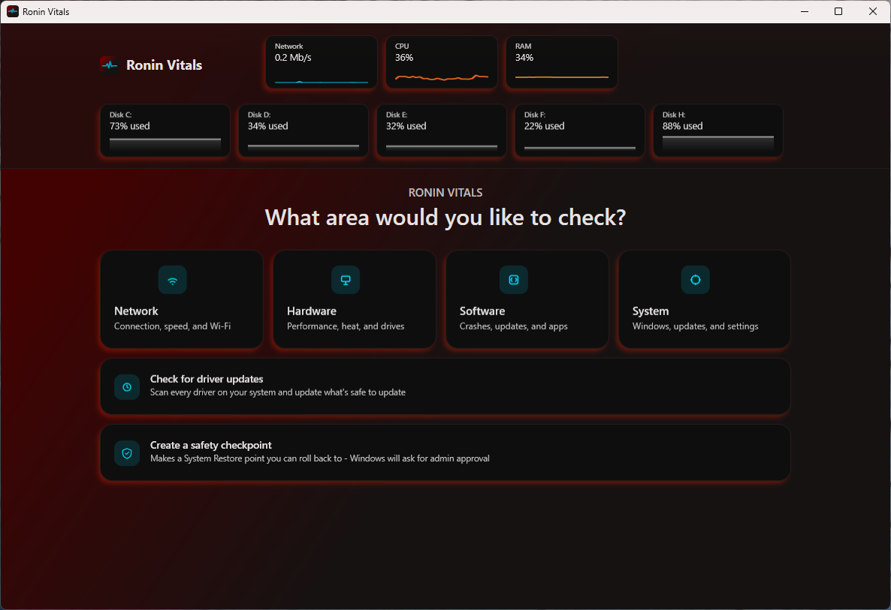
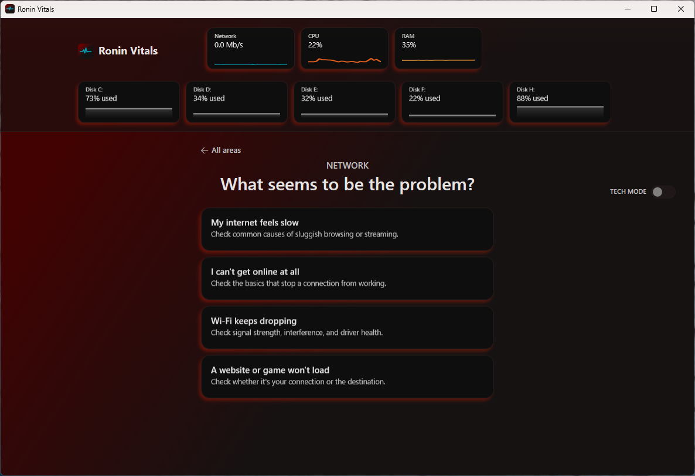
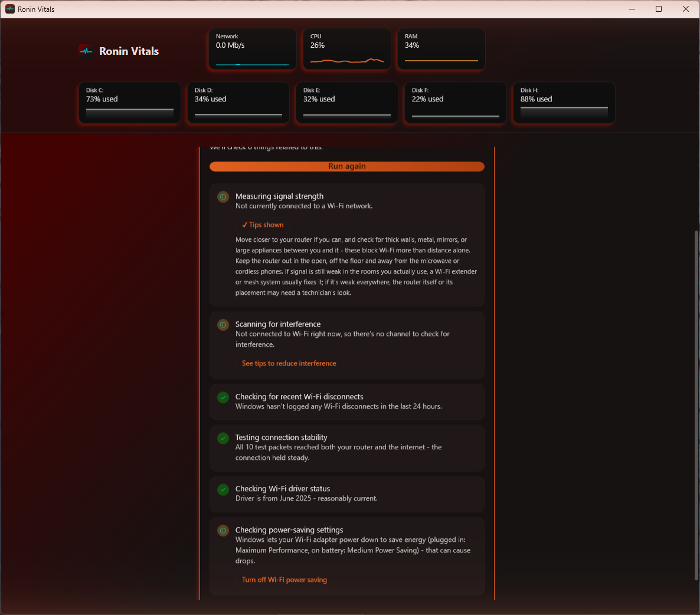
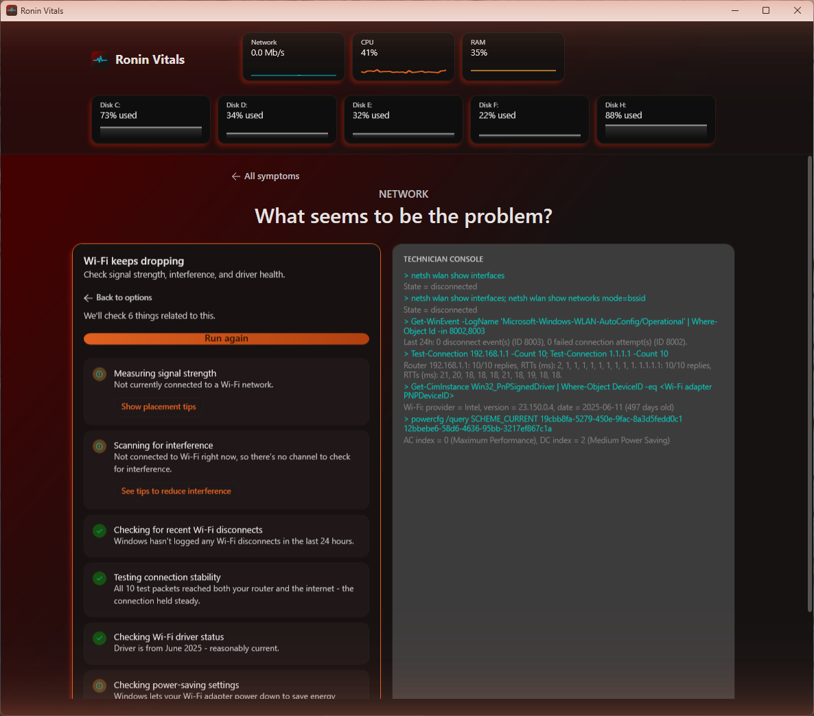

# Ronin Vitals

A Windows diagnostic and repair tool for people who are not technical. Pick what feels wrong ("my internet feels slow", "Wi-Fi keeps dropping"), press one button, and Vitals runs the relevant checks, explains each result in plain language, and tells you what to do about it: a fix you can do yourself, a fix Vitals can apply for you, or a clear "this needs a technician / your ISP / your IT department".

A **Tech Mode** switch reveals the same results the way a technician wants to see them: the exact command behind each check and the raw numbers, plus a live PowerShell console.

> **Status: early and under active development.** Some symptom cards have been reviewed end to end and use real checks only. Others still contain placeholder results. See [What works today](#what-works-today) for exactly which.



## How it works

You choose an area, then a symptom. Each symptom is a card with a short list of checks.



Opening a card shows a short "Gathering information" step, then the checklist. Press **Run diagnostic** and the checks run one at a time. Each ends as pass, warning or problem, with a one-line explanation. Anything that is not a pass has a button underneath that either explains what to do or, where it is safe, does it for you.



In the screenshot above this PC's Wi-Fi is disconnected (it is on Ethernet), so the signal and interference checks say so instead of pretending to measure something. The power-saving check found a real setting worth changing, and offers a button for it.

### Tech Mode

Flip **Tech Mode** on and the checklist slides left while a **Technician Console** opens beside it. For every check it shows the command behind the result (or the closest PowerShell equivalent, for checks that call .NET or WMI directly) and the raw reading, instead of the friendly sentence. The box underneath is a real PowerShell session you can type into.



The checklist on the left stays exactly as a normal user would see it. Tech Mode only adds, it never changes what the regular view says.

## What works today

Four areas and 14 symptom cards: **Network**, **Hardware**, **Software**, **System**. The cards are being reviewed one at a time, and three are finished.

**Placeholder checks do not look at your PC.** A check that is not yet real shows a fixed example result, so it can say something that is not true of your machine. Treat those as demo content. They are listed below so you can tell them apart.

| Card | State |
| --- | --- |
| Network: My internet feels slow | **Finished.** All 8 checks are real. |
| Network: I can't get online at all | **Finished.** All 5 checks are real. |
| Network: Wi-Fi keeps dropping | **Finished.** All 6 checks are real. |
| Network: A website or game won't load | 3 real checks, 1 placeholder (browser cache). Next in line. |
| Hardware: My computer feels slow | All real (CPU, memory, disk activity, startup programs, fragmentation). Not yet reviewed for missing causes. |
| Hardware: A drive might be failing | All real (drive health, free space, disk errors). Not yet reviewed. |
| Hardware: Not sure - check everything | 3 real, 1 placeholder (temperatures). |
| Hardware: Fans are loud or it's overheating | **All placeholders.** |
| Software: A program keeps crashing | 1 real (crash log), 2 placeholders. |
| Software: Something's using too much CPU or RAM | 1 real (top CPU users), 1 placeholder. |
| Software: Computer won't start up properly | **All placeholders.** |
| System: Windows won't update | All real (update service, disk space, stuck update files). Not yet reviewed. |
| System: General health check | 2 real (update status, recent errors), 1 placeholder (system files). |
| System: Settings keep resetting or acting weird | **All placeholders.** |

Some "fix" buttons on unreviewed cards are not wired to anything yet. The driver-update screen is also a demo: it does not install anything.

A few checks are placeholders on purpose, because a confidently wrong answer is worse than none. CPU temperature is the main example: reading it accurately needs a kernel driver, which is a bigger trust decision than this project has made so far.

Some things the checks do that go beyond a simple "is it on":

- Tell **why** there is no connection (adapter disabled, cable unplugged, or no adapter at all).
- Tell **which side of your router** a problem is on, with ping tests to the router and to the internet.
- Read the Windows Wi-Fi event log for real disconnects instead of guessing.
- Notice when you are on Ethernet and skip Wi-Fi checks that do not apply.
- Measure whether your connection falls apart under load (bufferbloat) with a short background download.

## Safety

This tool is meant to be safe to run on a machine you care about.

- **Checks only read.** Registry reads, WMI queries, event log reads, pings and DNS lookups. They do not change settings.
- **Fixes are few, small and reversible.** Today: flush the DNS cache, renew the IP address, clear temporary files, and turn off Wi-Fi power saving. The last one remembers your previous values and has an **Undo** button.
- **Fixes go through one gate.** Each fix has a safety tier. A fix marked as needing confirmation must create a System Restore point first and refuses to run if it cannot. None of today's four needs one, but the gate is built and was tested with a standalone "Create a safety checkpoint" button on the home screen.
- **Everything is logged.** Applied fixes appear in an on-screen action log in plain language, with undo while it is still available.
- **Tech Mode is the exception.** The console is a real PowerShell session. It bypasses the fix gate, creates no restore point and cannot be undone. It is off by default and meant for someone who knows what they are typing.

The app asks for administrator rights at launch, because a few checks (HDD fragmentation, restore points) need them. Windows shows one prompt when it starts.

## Build and run

You need Windows 10 or 11 and the [.NET 8 SDK](https://dotnet.microsoft.com/download/dotnet/8.0).

```bash
git clone https://github.com/PhonicSpider/Ronin-Vitals.git
cd Ronin-Vitals
dotnet build
dotnet test
```

Run the app from `RoninVitals/bin/Debug/net8.0-windows/RoninVitals.exe`. Windows will show the administrator prompt.

For development, `dotnet watch run` from an elevated terminal in the `RoninVitals` folder applies most XAML changes live.

## How it is built

WPF on .NET 8, using MVVM with [CommunityToolkit.Mvvm](https://github.com/CommunityToolkit/dotnet). No other UI framework.

- `Services/VitalsCatalog.cs` defines every area, symptom and check, and the guidance text for each. This is the file to read first.
- A check is a `CheckDefinition`. If it has a `RealCheck`, that function runs on a background thread and returns a `CheckResult`: a status, a friendly sentence, and optionally the command and raw detail that Tech Mode shows.
- The check logic lives in `Services/`: `NetworkDiagnosticsService`, `WifiDiagnosticsService`, `SpeedTestService`, `SystemDiagnosticsService`, `DriveHealthService`, `EventLogDiagnosticsService` and a few others. Each file's header comment says what it reads and why.
- Fixes are a function plus a safety tier. `SafeFixService` enforces the tier, `ActionLogService` records the result.
- `PowerShellConsoleService` hosts the Tech Mode shell.
- `RoninVitals.Tests` holds the unit tests (xUnit). They cover the catalog, view models and converters. Checks that read the real machine are tested by running them, not mocked.

## Credits

Interface fonts are bundled under the SIL Open Font License: Space Grotesk, Inter and IBM Plex Mono. The license texts are in `RoninVitals/Assets/Fonts`.

## License

Not yet decided. Until one is added, all rights are reserved by the author.
